# مستند جامع مدیریت Git پروژه

این سند، مرجع کامل و گام‌به‌گام برای مدیریت کدها، شبیه‌سازی‌ها، پروژه‌های Vivado، مستندات و شاخه‌های Git در طول ترم برای آزمایشگاه معماری کامپیوتر است. هدف این چرخه، نگهداری هر فاز روی یک شاخه (Branch) مجزا به همراه پروژه آماده Vivado و تمام نتایج و اسکرین‌شات‌های آن، و در عین حال داشتن آخرین نسخه کامل و تجمیعی پردازنده روی شاخه `main` است.

---

## بخش ۱: ساختار استاندارد پوشه‌بندی پروژه (Directory Structure)

قبل از شروع کار با شاخه‌ها، ساختار پوشه‌های پروژه را به این شکل مرتب کنید تا فایل‌های سنتز، شبیه‌سازی، مستندات هر جلسه و پروژه‌های Vivado هر فاز به صورت تمیز و بدون تداخل کنار هم قرار بگیرند:

```text
ARM_Processor_Lab/
├── .gitignore                 # Ignore rules for temporary Vivado & HDL files
├── README.md                  # General project documentation
├── docs/                      # Lab reports, waveform screenshots, and ILA captures
│   ├── 01-if/                 # Session 1 results (IF stage)
│   ├── 02-id/                 # Session 2 results (ID stage)
│   ├── 03-exe/                # Session 3 results (EXE stage)
│   ├── 04-mem/                # Session 4 results (MEM stage)
│   ├── 05-wb/                 # Session 5 results (WB stage)
│   ├── 06-hazard/             # Session 6 results (Hazard Detection)
│   └── 07-forwarding/         # Session 7 results (Forwarding Unit)
├── src/                       # Synthesizable HDL source files (SystemVerilog / Verilog)
│   ├── pkg/                   # Packages, constants, and type definitions (e.g., arm_pkg.sv)
│   ├── stages/                # Modular pipeline stages
│   │   ├── 01_IF/             # PC, Instruction MemoryWrapper, IF_Stage, IF_ID_Reg
│   │   ├── 02_ID/             # RegisterFile, ControlUnit, ConditionCheck, ID_Stage, ID_EXE_Reg
│   │   ├── 03_EXE/            # ALU, Val2Generator, EXE_Stage, EXE_MEM_Reg
│   │   ├── 04_MEM/            # DataMemoryWrapper, MEM_Stage, MEM_WB_Reg
│   │   └── 05_WB/             # WB_Stage
│   ├── units/                 # Auxiliary control units
│   │   ├── Hazard_Unit.sv
│   │   └── Forwarding_Unit.sv
│   └── ARM_Top.sv             # Top-level module connecting all pipeline stages
├── tb/                        # Verification testbenches
│   ├── tb_IF.sv               # Stage 1 dedicated testbench
│   └── tb_ARM_Top.sv          # Full processor top-level testbench
├── ip_coe/                    # Memory initialization files (.coe)
├── constraints/               # FPGA board physical constraints (.xdc)
└── vivado_projects/           # Ready-to-open Vivado projects per stage (.xpr)
    ├── 01_IF_Proj/            # Session 1 standalone Vivado project
    ├── 02_ID_Proj/            # Session 2 standalone Vivado project (Created via Save As)
    ├── 03_EXE_Proj/           # Session 3 standalone Vivado project
    ├── 04_MEM_Proj/           # Session 4 standalone Vivado project
    ├── 05_WB_Proj/            # Session 5 standalone Vivado project
    ├── 06_Hazard_Proj/        # Session 6 standalone Vivado project
    └── 07_Forwarding_Proj/    # Session 7 standalone Vivado project

```

---

## بخش ۲: راه‌اندازی اولیه و تنظیم `.gitignore` (فقط یک‌بار در ابتدای پروژه)

نرم‌افزار Vivado گیگابایت‌ها فایل کش، لاگ و خروجی موقت تولید می‌کند که اگر وارد Git شوند، تغییر شاخه (`checkout`) و ادغام (`merge`) را غیرممکن می‌کنند. با تنظیم زیر، تمام این فایل‌های سنگین حذف می‌شوند اما فایل اصلی پروژه (`.xpr`)، تنظیمات IPها (`.xci`) و طراحی‌های بلوکی (`.bd`) سالم در گیت باقی می‌مانند تا هر کس مخزن را Clone کرد، مستقیماً پروژه آماده اجرا را باز کند.

**گام ۱:** در پوشه اصلی پروژه، فایلی به نام `.gitignore` بسازید و دقیقاً محتویات زیر را داخل آن قرار دهید:

```gitignore
# ==========================================
# Vivado Auto-Generated Directories
# ==========================================
*.cache/
*.hw/
*.ip_user_files/
*.runs/
*.sim/
*.gen/
.Xil/

# ==========================================
# Keep IP (.xci) & Block Design (.bd) Configs, Ignore Generated Output Products
# ==========================================
*.srcs/sources_1/ip/*/*
!*.srcs/sources_1/ip/*/*.xci
*.srcs/sources_1/bd/*/*
!*.srcs/sources_1/bd/*/*.bd

# ==========================================
# Vivado Logs, Journals & Waveforms
# ==========================================
*.jou
*.log
*.str
*.wdb
*.vcd
*.pb
*.dcp
*.bit
*.ltx
webtalk*

# ==========================================
# Verilator & OS Temporary Files
# ==========================================
obj_dir/
.DS_Store
Thumbs.db
*~

```

**گام ۲:** اگر فایل `.gitignore` را تازه ساخته‌اید یا تغییر داده‌اید، آن را روی شاخه `main` ثبت کنید:

```bash
# Switch to main branch and stage the .gitignore file
git checkout main
git add .gitignore
git commit -m "chore: add standard Vivado and HDL .gitignore"
git push origin main

```

---

## بخش ۳: قوانین طلایی مدیریت پروژه‌های Vivado در Git (بسیار مهم)

برای اینکه بتوانید برای هر Stage یک پروژه Vivado مجزا روی گیت قرار دهید که هم‌گروهی یا TA با دو بار کلیک روی فایل `.xpr` بدون خطای `File Not Found` آن را باز کند و از طرفی تنظیمات جلسات قبل را هم از دست ندهید، این ۳ قانون را همیشه رعایت کنید:

1. **ممنوعیت Copy/Paste دستی پوشه پروژه:** هرگز پوشه پروژه Vivado (مثلاً `01_IF_Proj`) را در ویندوز یا لینوکس به صورت دستی کپی و تغییر نام ندهید! فایل `.xpr` در داخل خود مسیرهای دقیق پوشه قبلی را نگه می‌دارد و با تغییر نام دستی، پروژه خراب می‌شود.
2. **ساخت پروژه مرحله جدید با `Save Project As`:** در ابتدای هر جلسه جدید (مثلاً جلسه دوم `ID`)، پروژه جلسه قبل (`01_IF_Proj.xpr`) را در Vivado باز کنید و از منوی بالا گزینه **`File -> Project -> Save As...`** را بزنید. نام آن را `02_ID_Proj` بگذارید و در پوشه `vivado_projects/` ذخیره کنید (تیک گزینه *Import all files to the new project* را **نزنید**). با این کار، یک پروژه جدید و کاملاً سالم ساخته می‌شود که تمام کدهای `IF`، تنظیمات برد FPGA و IPهای جلسه قبل را از قبل داخل خود دارد.
3. **برداشتن تیک کپی هنگام افزودن کدها (`Add Sources`):** هر زمان در Vivado فایلی از پوشه‌های `src/`، `tb/`، `ip_coe/` یا `constraints/` اضافه می‌کنید، در پنجره `Add Sources` **حتماً تیک گزینه `Copy sources into project` را بردارید (Uncheck کنید).** با این کار، Vivado به جای کپی کردن فایل‌ها به داخل پوشه‌های تو در توی خودش، با آدرس نسبی (`../../src/...`) به فایل‌های اصلی شما لینک می‌شود؛ در نتیجه پروژه روی هر کامپیوتر دیگری بدون خطا باز شده و تغییرات کد در VS Code بلافاصله در Vivado اعمال می‌شود.

---

## بخش ۴: معماری و گراف شاخه‌ها در طول ترم

در این استراتژی:

1. هر مرحله از روی آخرین وضعیت پایدار `main` منشعب می‌شود.
2. کدهای آن مرحله + پروژه Vivado اختصاصی آن مرحله + تست‌ها + عکس‌های گزارش کار روی شاخه همان مرحله کامیت می‌شوند.
3. در پایان مرحله، شاخه با فلگ `--no-ff` (بدون ادغام خطی، جهت حفظ ساختار گرافیکی شاخه در تاریخچه) به `main` مرج شده و تگ می‌خورد.

```mermaid
flowchart LR
    init([Init Project]) --> m0([main])
    
    m0 -.-> s1[stage/01-if]
    s1 --> m1([Merge & Tag: v0.1-if])
    m0 --> m1

    m1 -.-> s2[stage/02-id]
    s2 --> m2([Merge & Tag: v0.2-id])
    m1 --> m2

    m2 -.-> s3[stage/03-exe]
    s3 --> m3([Merge & Tag: v0.3-exe])
    m2 --> m3

    m3 -.-> s4[stage/04-mem]
    s4 --> m4([Merge & Tag: v0.4-mem])
    m3 --> m4

    m4 -.-> s5[stage/05-wb]
    s5 --> m5([Merge & Tag: v0.5-wb])
    m4 --> m5

```



---

## بخش ۵: تثبیت وضعیت فعلی (مخصوص مرحله اول `IF` که الان نوشته‌اید)

از آنجایی که کدهای جلسه اول (`IF`) را قبلاً روی `main` زده‌اید و می‌خواهید آن را وارد این ساختار شاخه‌ای کنید، این دستورات را **همین الان یک‌بار** اجرا کنید تا پایه کار برای جلسات بعدی درست شود:

```bash
# 1. Ensure Vivado is completely closed before running Git commands!

# 2. Create and switch to the Stage 1 branch from the current state
git checkout -b stage/01-if

# 3. Create the documentation directory for Stage 1 (place your waveform/ILA screenshots here)
mkdir -p docs/01-if

# 4. Stage all files and commit the final state of the IF stage
# Note: --allow-empty ensures the commit is created even if no new files were modified
git add .
git commit --allow-empty -m "feat(IF): complete IF stage, pipeline registers and results"

# 5. Push the Stage 1 branch to GitHub and set upstream tracking
git push -u origin stage/01-if

# 6. Switch back to main and merge the Stage 1 branch (preserving branch topology with --no-ff)
git checkout main
git merge --no-ff stage/01-if -m "merge: integrate stage/01-if into main"

# 7. Create an annotated Git tag for the Session 1 milestone delivery
git tag -a v0.1-if -m "Release v0.1-if: Instruction Fetch Stage Verified"

# 8. Push the updated main branch and all tags to GitHub
git push origin main
git push origin --tags

```

---

## بخش ۶: دستورالعمل گام‌به‌گام برای هر جلسه جدید (از `ID` تا پایان ترم)

از جلسه آینده (پیاده‌سازی `ID`، سپس `EXE` و الی آخر)، در هر جلسه آزمایشگاه دقیقاً طبق این ۷ گام عمل کنید:

1. **آماده‌سازی و ساخت شاخه جدید در ترمینال (الزامی: قبل از اجرای دستورات، نرم‌افزار Vivado باید بسته باشد):**
در ابتدای جلسه آزمایشگاه، ترمینال را باز کنید، به آخرین نسخه شاخه اصلی بروید و شاخه مرحله جدید را بسازید (دستور `git checkout -b` هم‌زمان شاخه جدید را می‌سازد و وارد آن می‌شود):

```bash
# 1. Switch to main branch and pull the latest changes
git checkout main
git pull origin main

# 2. Create and switch to the new stage branch (update branch name per session according to Section 7)
git checkout -b stage/02-id

```

2. **ساخت پروژه Vivado مرحله جدید از روی مرحله قبل (`Save As`):**

* نرم‌افزار Vivado را باز کنید و پروژه جلسه قبل (مثلاً `vivado_projects/01_IF_Proj/01_IF_Proj.xpr`) را باز کنید.
* از منوی **`File -> Project -> Save As...`** یک پروژه جدید به نام `02_ID_Proj` داخل پوشه `vivado_projects/` بسازید (بدون تیک زدن *Import all files*).
* حالا پروژه جدید آماده است و کدهای قبلی را می‌شناسد. هر فایل `.sv` جدیدی که در این جلسه می‌سازید، با `Add Sources` (بدون تیک *Copy sources into project*) به این پروژه اضافه کنید.

3. **کدنویسی گام‌به‌گام و ثبت کامیت‌های ماژولار:**
به جای اینکه کل کدهای جلسه را در ثانیه آخر کامیت کنید، هر ماژول که تکمیل شد یک کامیت تمیز با پیام انگلیسی استاندارد بزنید:

```bash
# Example 1: Commit after implementing the Register File module
git add src/stages/02_ID/RegisterFile.sv
git commit -m "feat(ID): implement 15-word register file with R15 support"

# Example 2: Commit after implementing Control Unit and Condition Check
git add src/stages/02_ID/ControlUnit.sv src/stages/02_ID/ConditionCheck.sv
git commit -m "feat(ID): add control unit and condition check logic"

# Example 3: Commit after wiring the ID stage in Top-Level and updating the Vivado project
git add src/stages/02_ID/ src/ARM_Top.sv vivado_projects/02_ID_Proj/
git commit -m "feat(ID): connect ID stage, pipeline registers and add 02_ID_Proj"

```

4. **شبیه‌سازی، تست روی برد (ILA) و ثبت ریزالت‌ها در شاخه:**
پس از اجرای شبیه‌سازی در Vivado یا تست روی برد FPGA:
5. اسکرین‌شات‌های محیط موج (Waveform)، خروجی‌های ILA و توضیحات آن جلسه را داخل پوشه `docs/02-id/` ذخیره کنید.
6. آن‌ها را روی همین شاخه کامیت کنید تا پرونده این شاخه کامل شود:

```bash
# Stage and commit session documentation, waveforms, testbenches, and Vivado project updates
git add docs/02-id/ tb/ vivado_projects/02_ID_Proj/
git commit -m "docs(ID): add simulation waveforms and ILA capture results"

```

5. **پاکسازی کدهای موقت دیباگ (در صورت وجود) و Push شاخه:**
اگر برای تست این جلسه، ماژول‌های موقتی مثل `ILA` یا سیم‌های دیباگ موقتی داخل `ARM_Top.sv` گذاشته‌اید که در جلسه بعد (`EXE`) مزاحم هستند:
6. ابتدا شاخه فعلی را پوش کنید تا نسخه حاوی دیباگ در تاریخچه باشد:

```bash
# Push the current stage branch to remote repository
git push -u origin stage/02-id

```

2. در صورت نیاز، سیم‌های اضافه دیباگ را در `ARM_Top.sv` تمیز کنید و یک کامیت پایانی بزنید (عکس‌ها و نتایج در پوشه `docs/02-id` دست‌نخورده باقی می‌مانند):

```bash
# Optional: Clean up temporary debug probes from top module before merging to main
git add src/ARM_Top.sv
git commit -m "chore(ID): clean up temporary ILA probes before merging to main"
git push origin stage/02-id

```

6. **بستن Vivado و ادغام (Merge) در شاخه main (هشدار: اگر Vivado هنگام Merge باز باشد، فایل پروژه خراب می‌شود):**
ابتدا برنامه **Vivado را کاملاً ببندید**. سپس تغییرات تاییدشده مرحله را به شاخه اصلی (`main`) منتقل کنید:

```bash
# 1. Verify working tree is clean and no uncommitted files remain
git status

# 2. Switch back to the main branch
git checkout main

# 3. Merge the completed stage branch into main using --no-ff to preserve branch history
git merge --no-ff stage/02-id -m "merge: integrate ID stage (stage/02-id) into main"

```

7. **ثبت Tag تحویل جلسه و ارسال نهایی به سرور:**
برای اینکه هر زمان تی‌ای یا استاد خواست وضعیت دقیق پایان این جلسه را ببیند، یک تگ نسخه روی آن بزنید و همه چیز را روی GitHub ذخیره کنید:

```bash
# 1. Create an annotated tag for the milestone release
git tag -a v0.2-id -m "Release v0.2-id: Instruction Decode Stage Completed"

# 2. Push the updated main branch and tags to GitHub
git push origin main
git push origin --tags

```

---

## بخش ۷: جدول نام‌گذاری شاخه‌ها، پروژه‌ها و تگ‌ها در طول ترم

در هر جلسه از نام‌های استاندارد زیر در دستورات بخش ۶ استفاده کنید:

| شماره فاز | موضوع آزمایشگاه | نام شاخه (`Branch Name`) | پوشه پروژه Vivado | نام تگ پایان جلسه (`Tag`) | پوشه مستندات |
| --- | --- | --- | --- | --- | --- |
| **فاز ۱** | واکشی دستور (Instruction Fetch) | `stage/01-if` | `vivado_projects/01_IF_Proj/` | `v0.1-if` | `docs/01-if/` |
| **فاز ۲** | رمزگشایی و فایل ثبات‌ها (Instruction Decode) | `stage/02-id` | `vivado_projects/02_ID_Proj/` | `v0.2-id` | `docs/02-id/` |
| **فاز ۳** | اجرا، ALU و شیفتر (Execute Stage) | `stage/03-exe` | `vivado_projects/03_EXE_Proj/` | `v0.3-exe` | `docs/03-exe/` |
| **فاز ۴** | دسترسی به حافظه داده (Memory Stage) | `stage/04-mem` | `vivado_projects/04_MEM_Proj/` | `v0.4-mem` | `docs/04-mem/` |
| **فاز ۵** | بازنویسی در ثبات (Write Back & Full Pipe) | `stage/05-wb` | `vivado_projects/05_WB_Proj/` | `v0.5-wb` | `docs/05-wb/` |
| **فاز ۶** | تشخیص مخاطره و توقف (Hazard Detection) | `feature/06-hazard` | `vivado_projects/06_Hazard_Proj/` | `v0.6-hazard` | `docs/06-hazard/` |
| **فاز ۷** | واحد پیش‌راندن داده (Forwarding Unit) | `feature/07-forwarding` | `vivado_projects/07_Forwarding_Proj/` | `v1.0-final` | `docs/07-forwarding/` |

---

## بخش ۸: دستورات نجات و مرجع سریع ترمینال (Troubleshooting & Cheat Sheet)

در طول ترم یا روز تحویل نهایی به تی‌ای، این دستورات به کارتان می‌آیند:

* **۱. بررسی اینکه الان روی کدام Branch هستید و چه شاخه‌هایی وجود دارد:**

```bash
# List all local branches (the current active branch is marked with an asterisk *)
git branch

```

* **۲. نمایش گرافیکی و زیبای شاخه‌ها، کامیت‌ها و مرج‌ها در ترمینال (برای نشان دادن به TA):**

```bash
# Display a visual ASCII graph of all branches, merges, and tags
git log --graph --oneline --decorate --all

```

* **۳. بازگشت موقت به یکی از جلسات قبلی در روز تحویل (بدون خراب شدن کدهای فعلی):**
اگر در جلسه ۵ هستید و تی‌ای می‌خواهد کد و خروجی جلسه ۲ (`ID`) را ببیند:

```bash
# Ensure Vivado is closed and all current changes are committed before switching!
git checkout stage/02-id

# After demonstrating Stage 2, switch back to your current active branch:
git checkout stage/05-wb

```

* **۴. تغییر نام یا حذف شاخه‌ای که اشتباهی ساخته‌اید:**

```bash
# Rename the branch you are currently on to a new name
git branch -m new-branch-name

# Delete an unwanted local branch (must switch to main first before deleting)
git checkout main
git branch -d wrong-branch-name

```

* **۵. اگر فایل `.xpr` ویوادو موقع تغییر شاخه یا مرج دچار Conflict شد:**
با اینکه پروژه‌های هر مرحله در پوشه‌های جداگانه (`01_IF_Proj`, `02_ID_Proj`, ...) ذخیره می‌شوند و تداخل رخ نمی‌دهد، اگر احیاناً پروژه مرحله قبلی را هم باز کرده باشید و هنگام مرج به `main` با Conflict روی فایل `.xpr` مواجه شدید، نسخه شاخه جدید (`theirs`) را انتخاب کنید:

```bash
# Resolve .xpr conflict by accepting the incoming stage branch version
git checkout --theirs vivado_projects/*/*.xpr
git add vivado_projects/*/*.xpr
git commit -m "merge: resolve vivado project file conflict using latest stage"

```